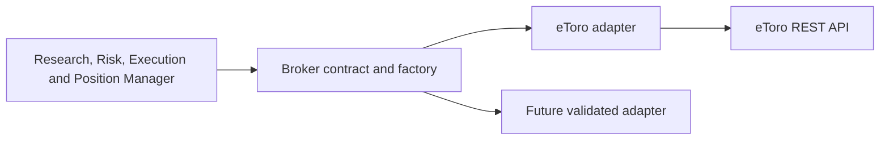

# Broker boundary and eligibility semantics

Updated 24 October 2026. eToro is the implemented demo execution adapter. IBKR is not implemented; selecting an unimplemented provider fails closed rather than using eToro or Yahoo as a substitute execution source.

## Separation

- `brokers/etoro.py` owns eToro endpoints, authentication headers, response parsing, instrument flags, quote reads, order payloads, account reads and provider diagnostics. It imports neither the application nor `integrations.py`.
- `brokers/contracts.py` defines the public instrument, quote, account, order and recovery interface, normalized eligibility reasons, and the active-provider ownership guard.
- `brokers/factory.py` selects providers. New adapters register once; registration alone does not enable demo execution. Explicit demo readiness and a complete public contract are required. Unsupported providers never fall back to another broker.
- `brokers/errors.py` distinguishes failures before an order request from transport/API failures. `brokers/parsing.py` contains payload conversion/redaction helpers.
- The core obtains adapters through the factory and reads normalized dictionaries. Recovery uses public `get_rate`, not an eToro private method. `integrations.py` retains compatibility exports and the provider-neutral orchestration entry points.

Old eToro-named workflow functions, account-lock name and session evidence keys remain compatibility entry points/aliases for the deployed account. They do not select endpoints or interpret raw eToro flags. Existing GUI broker setup is still eToro-specific. This is an adapter architecture, not a claim that a second broker is operational today.

## Instrument identity versus execution eligibility

The official [eToro OpenAPI specification](https://api-portal.etoro.com/api-reference/openapi.json) defines `isCurrentlyTradable`, `isExchangeOpen`, `isActiveInPlatform`, `isDelisted`, and `isBuyEnabled` as distinct flags. HTTP 200 means the read succeeded; it does not mean an order was accepted or the instrument can trade.

Instrument lookup resolves the exact symbol and stable broker ID without treating market closure as a lookup failure. Its normalized result preserves `resolved`, `supported_asset`, `currently_tradeable`, `exchange_open`, `platform_active`, `delisted`, `buy_enabled`, and `short_enabled`, plus the original provider evidence. Missing flags remain unknown; unknown current tradability does not authorize an order.

Closed exchange, inactive platform status, delisting and directional restrictions produce separate reasons. An inactive flag is not assumed to mean merely closed for the weekend, and `isBuyEnabled=true` does not override other negative eligibility flags. Rivian's observed combination of closed exchange, currently untradable, inactive platform and not delisted must retain all four facts.

## Quote semantics

A rates read is independent of permission to submit an order. The adapter can obtain indicative bid/ask prices even when an instrument is closed/inactive. It retains:

- `available`: valid bid/ask prices were obtained.
- `executable`: the adapter's instrument and quote checks permit those prices to be used for execution.
- `status`: `executable`, `indicative`, `invalid_quote`, or `request_failed`, with a specific reason.
- `fetched_at`: local retrieval time; `quote_at`: provider timestamp when supplied.

Delayed quotes and stale parsed provider timestamps are non-executable. When the rates payload provides no usable timestamp, the provider time remains unknown rather than being invented; the existing retrieval-age check still applies. Core submission independently rechecks the quote and risk. A failed read, an invalid quote and an expired quote are different cases. Full risk evidence retains normalized instrument and quote data for inspection.

## Orders and recovery

Eligibility failures are `BrokerPreflightError(request_sent=false)`. They are not broker order rejections or pending orders. After the write request begins, a definitive API refusal and an uncertain outcome remain distinct; an uncertain outcome requires reconciliation and must not be resubmitted blindly. Existing lifecycle labels and manual research-expiry limits continue to apply. No automatic retry queue was added.

## Adding or switching a broker

Implement every public method and normalize returned values to the existing contract: symbols and instrument IDs, LONG/SHORT, actual units, margin, equity/cash, UTC timestamps, protection levels, order references and closed net outcomes. Implement lookup, cancel, protection and closure recovery as well as submission. Reject unsupported capabilities explicitly; never emulate them through another provider. Validate account currency, quantity precision, leverage, supported order types, idempotency and ambiguous transport outcomes in provider-specific tests before marking an adapter demo-ready.

The active database belongs to one trading profile and broker account. Runtime adapter construction checks its stored provider binding before broker requests: toggling to another provider cannot reinterpret eToro position IDs. Changing credentials to another account of the same provider also requires an explicit account migration and reconciliation; account references are not yet sufficient for automatic account switching. Simultaneous multi-account/multi-broker runtimes remain outside the current single-runtime design.

## Verification

Tests cover the actual Rivian flag combination; indicative, invalid, delayed, stale and failed quotes; no POST on failed eligibility; an independent fake broker through the same factory/submission boundary; disabled unimplemented providers; and rejection of provider changes against an existing account binding. Existing workflow tests cover fill/protection reconciliation, closure recovery, uncertain orders and duplicate prevention through the public adapter methods.

## Broker-specific symbol mapping — 29 October 2026

Research and subsequent agents retain their source ticker and company identity.
The eToro adapter translates only at its public quote/instrument, cost-estimate
and order boundary. Verified aliases live in `brokers/etoro_symbols.py`; a future
broker owns its own translation without changing Researcher/Strategist logic.

The first verified alias is Chevron: research `CVX` → eToro `CVX.US`, instrument
1014, equity on NYSE. The broker's exact `CVX` refers to a different crypto asset
(instrument 100512). The alias pins the broker symbol, instrument ID, asset class
and exchange; unexpected or missing identity data blocks resolution. No other
listing or ticker suffix is guessed. In particular, SSAB-A.ST remains unresolved
until a corresponding broker instrument is verified.

Unmapped tickers retain unique exact-symbol matching. Multiple conflicting
matches are an explicit ambiguity error, never a first-result choice. Identical
repeated rows may be deduplicated. Identity selection does not override inactive,
closed-market, unsupported-currency or directional restrictions. Broker lookups
and final submission recheck the mapping; an unavailable lookup is an execution
block, not a research reclassification or an invitation to switch assets.

Normalized evidence retains the original `symbol`/`research_symbol`, separate
`broker_symbol` and `symbol_resolution` provenance. Quote `ticker` stays the
research symbol; `quote_symbol` identifies the broker symbol. Cost requests use
the same validated broker symbol, and orders use its validated instrument ID.
Historical research/positions are not rewritten or replayed by this update.
